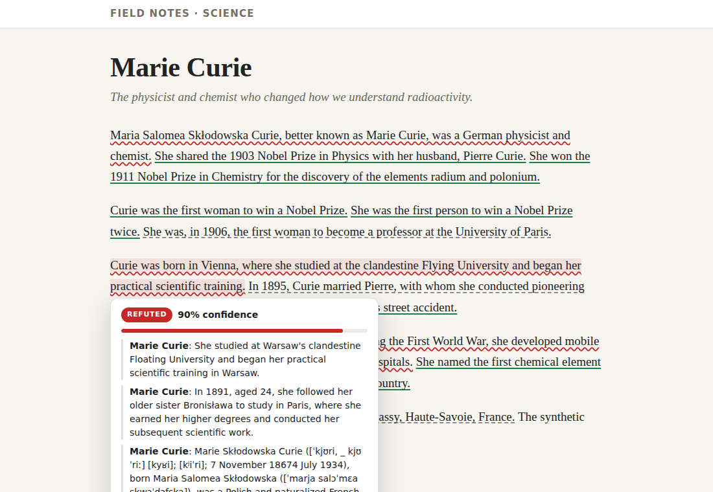
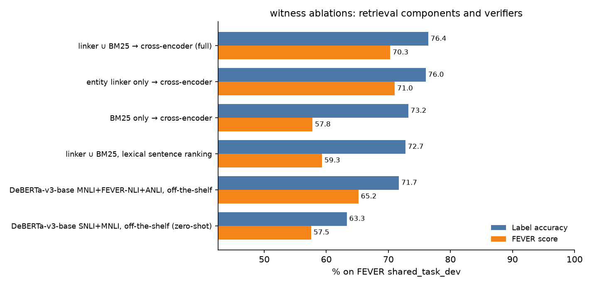
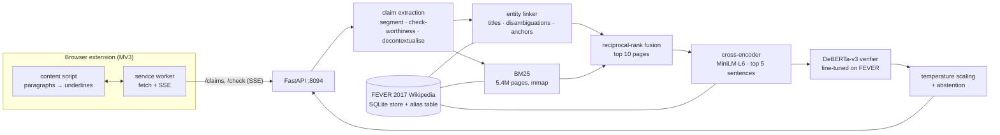

# witness

**A local fact-checker that underlines every claim on any webpage.** Green if Wikipedia
supports it, red if it contradicts it, grey if it can't tell, and the evidence is one
hover away. Entity linking + BM25 over 5.4M Wikipedia pages, a cross-encoder evidence
ranker and a DeBERTa-v3 verifier fine-tuned on FEVER. No cloud.

[](https://github.com/aamodbhatt/witness/actions/workflows/ci.yml)
[](LICENSE)


<sub>Recorded from the real extension and server (headless Chromium on the A40 pod, every
model on CPU, full index, fine-tuned verifier). The article is a
<a href="docs/demo/marie-curie.html">fixture</a> built from Wikipedia's "Marie Curie" lead
section (CC BY-SA 4.0) with **three facts deliberately altered**: her nationality
("German"), her birthplace ("Vienna") and the year she died ("1954"). In this recording
witness turns the first two red but leaves the death year grey, and it also marks one true
sentence red (the First World War radiography units). Of the 13 claims, 6 are green, 3 red
and 4 grey.</sub>

## Why

Reading the web means taking a lot of sentences on trust. Fact-checking tools mostly
live in a separate tab, check one claim at a time, or send your browsing to a server.
witness reads the page you are already on, decides which sentences are actually
checkable, and marks each one in place, using a Wikipedia index on your own disk.

## What it does

- **Underlines claims in place** (Chrome/Edge, Manifest V3, no build step): solid green,
  wavy red, dashed grey. Links and formatting inside a sentence survive.
- **Hover card** with the verdict, a calibrated confidence bar, the sentence as it was
  checked ("She" → "Marie Curie") and the top Wikipedia evidence sentences with links.
- **Popup** with the page summary and an on/off switch; **options page** for the server URL.
- **Skips what can't be checked**: questions, opinions ("I think", "the best"),
  boilerplate, fragments. Every skip has a reason in the API response.
- **Streams**: `/check` sends one Server-Sent Event per claim as soon as it is verified.
- **Paste page** at `http://127.0.0.1:8094/` and a CLI (`witness check`, `witness check-url`).
- **Measured**: FEVER label accuracy and FEVER score on all 19,998 `shared_task_dev`
  claims, ablations, calibration and latency, next to published baselines.



## Results

All 19,998 claims of FEVER `shared_task_dev`, scored with a reimplementation of the
official scorer. Hardware: single NVIDIA A40 (48 GB), ~8 vCPU. Nothing was tuned on dev;
the temperature was fit on 2,000 held-out FEVER *train* claims.

| System | Label acc. | FEVER score |
|---|---:|---:|
| **witness**: linker ∪ BM25 → MiniLM cross-encoder → DeBERTa-v3-base fine-tuned here | **76.41** | **70.29** |
| witness retrieval + DeBERTa-v3-base MNLI/FEVER-NLI/ANLI, off-the-shelf | 71.70 | 65.17 |
| witness retrieval + DeBERTa-v3-base SNLI/MNLI, off-the-shelf (zero-shot) | 63.29 | 57.55 |
| *Reported:* Athene (FEVER 2018 shared task) | 68.49 | 64.74 |
| *Reported:* UCL MRG (FEVER 2018 shared task) | 69.66 | 65.41 |
| *Reported:* UNC NLP (FEVER 2018 winner) | 69.72 | 66.49 |
| *Reported:* BERT Concat | 73.67 | 68.89 |
| *Reported:* GEAR | 74.84 | 70.69 |
| *Reported:* KGAT (RoBERTa-large) | 78.29 | 76.11 |

<sub>Reported numbers are dev-set figures copied from the KGAT paper (Liu et al., ACL 2020,
Table 2). They come from other retrieval stacks and verifiers trained on all of FEVER
train; witness's verifier saw a balanced 51k-claim sample for one epoch (11.3 minutes).</sub>



| Retrieval (fine-tuned verifier) | Doc recall | Evidence recall@5 | Label acc. | FEVER score |
|---|---:|---:|---:|---:|
| linker ∪ BM25 → cross-encoder (shipped) | 90.29 | 85.78 | 76.41 | 70.29 |
| entity linker only → cross-encoder | 86.13 | 83.75 | 76.01 | **71.02** |
| BM25 only → cross-encoder | 64.29 | 62.37 | 73.19 | 57.76 |
| linker ∪ BM25, lexical sentence ranking (no cross-encoder) | 90.29 | 61.13 | 72.74 | 59.30 |

What the ablations say, honestly:

- **The entity linker carries retrieval.** Alone it finds a complete gold page set for
  86% of verifiable claims; BM25 alone manages 64%. Fusing them adds 4 points of doc
  recall and 2 of evidence recall, but the extra BM25 pages also hand the verifier more
  distractors, and the linker-only variant ends up 0.7 FEVER points *higher*. The
  shipped default keeps fusion for its recall on claims that never name their entity;
  a learned fusion weight is on the roadmap.
- **The cross-encoder is the biggest single lever:** +24.6 points of evidence recall and
  +11 FEVER points over lexical sentence ranking on the same pages.
- **Fine-tuning helps every class,** most of all NOT ENOUGH INFO (F1 52.8 → 63.9), and is
  better calibrated before and after temperature scaling (ECE 0.125 → 0.050 at T = 1.53).
- **Dense retrieval is not included** in this version (see Roadmap), so there is no
  dense row.

Latency per claim in the batched evaluation: entity linking 1.3 ms, BM25 over 5.4M pages
14.4 ms (37 ms p95), page fetch + cross-encoder 17.6 ms. Through the server with **every
model on CPU**, the 13-claim demo page takes 16.2 s end to end (first verdict after
11.3 s); claim extraction runs at ~5,650 sentences/s. Full tables:
[docs/results/fever_dev.md](docs/results/fever_dev.md) and
[docs/results/fever_dev.json](docs/results/fever_dev.json).

## Quickstart

You need Python 3.12 and [uv](https://docs.astral.sh/uv/). No GPU and no training: the
quickstart builds the lite index (401k pages, ~0.8 GB, 3 to 7 minutes on 8 cores) and
serves the laptop profile, `configs/laptop.toml`, which runs every model on the CPU with
the off-the-shelf `MoritzLaurer/DeBERTa-v3-base-mnli-fever-anli` verifier (the model
witness fine-tunes from, downloaded from the Hugging Face Hub on first start).

**macOS / Linux**

```bash
git clone https://github.com/aamodbhatt/witness && cd witness
uv sync
mkdir -p data/raw && curl -L -o data/raw/wiki-pages.zip https://fever.ai/download/fever/wiki-pages.zip
uv run witness build-index --lite 500000 --out data/index/lite
uv run witness serve --config configs/laptop.toml      # http://127.0.0.1:8094
```

**Windows (PowerShell)**

```powershell
git clone https://github.com/aamodbhatt/witness; cd witness
uv sync
New-Item -ItemType Directory -Force data\raw | Out-Null
Invoke-WebRequest https://fever.ai/download/fever/wiki-pages.zip -OutFile data\raw\wiki-pages.zip
uv run witness build-index --lite 500000 --out data/index/lite
uv run witness serve --config configs/laptop.toml
```

Then load the extension: `chrome://extensions` (or `edge://extensions`) → Developer
mode → **Load unpacked** → pick the `extension/` folder. Open any article and hover an
underline. From a terminal, `uv run witness check --config configs/laptop.toml "Marie
Curie was born in Warsaw."` checks single claims.

The laptop profile is the quick path, not the measured one, and it has not been scored on
FEVER dev (with the full index its verifier scores 71.70 label accuracy, table above). On
the demo article it marks all three altered facts red, but also two true sentences (Pierre
Curie's death in 1906 and her 1906 professorship), and leaves 3 of the 13 claims grey.

**Full index and the fine-tuned verifier.** The results above use the full 5.4M-page
index and a verifier fine-tuned here. The fine-tuned weights (0.75 GB) are not
distributed, so reproducing them needs FEVER's `train.jsonl` and a CUDA GPU. The full
index needs ~7 GB of disk and builds in about 8 minutes on 8 cores.

```bash
uv run witness build-index --out data/index/full
curl -L -o data/raw/train.jsonl https://fever.ai/download/fever/train.jsonl
uv run witness train-verifier --stage examples                          # CPU, reads data/index/full
uv run witness train-verifier --stage train --config configs/pod.toml   # GPU: 11.3 min on an A40
uv run witness eval fever --split calib --limit 2000 --config configs/pod.toml   # optional: fits the temperature
uv run witness serve --config configs/cpu.toml                          # or configs/pod.toml on the GPU
```

On Windows the commands are the same; download `train.jsonl` with `Invoke-WebRequest`.
That setup on CPU:

```console
$ uv run witness check --config configs/cpu.toml "Marie Curie was born in Warsaw." "The Eiffel Tower is in Berlin." \
    "Barack Obama was the 44th President of the United States." "Tilda Swinton is a vegan."
SUPPORTED       94%  Marie Curie was born in Warsaw.
    [Marie Curie:5] She was born in Warsaw, in what was then the Kingdom of Poland, part of the Russian Empire.
REFUTED         89%  The Eiffel Tower is in Berlin.
    [Eiffel Tower:0] The Eiffel Tower (...) is a wrought iron lattice tower on the Champ de Mars in Paris, France.
SUPPORTED       97%  Barack Obama was the 44th President of the United States.
    [Barack (disambiguation):0] Barack Obama (born 1961) was the 44th President of the United States.
UNVERIFIABLE    97%  Tilda Swinton is a vegan.
    [Tilda Swinton:0] Katherine Matilda "Tilda" Swinton (born 5 November 1960) is a British actress, ...
```

<sub>Real output from `scripts/demo_session.sh`, trimmed to the top evidence line of three,
with IPA elided and the last line shortened.</sub>

## How it works



**The clever parts**

- **Entity linking is a lookup, not a model.** Every n-gram of a claim is matched against
  9.6M aliases mined from the dump itself: page titles, titles without their
  disambiguation suffix, and hyperlink anchor texts with link counts as a commonness
  prior. A disambiguated page gets a bonus when its suffix words occur in the claim
  ("film" picks *Soul Food (film)* over the soundtrack), and a mention nested inside a
  longer title ("Johann" inside "Johann Wolfgang von Goethe") is down-weighted. 1.3 ms per
  claim on average (3.0 ms p95), no GPU, and the strongest single retriever in the ablations.
- **BM25 over 5.4M pages in a 12 GB process.** A streaming builder produces the same
  eager-scored matrix as `bm25s` (tested to 1e-5) without holding the tokenized corpus
  in Python lists, and the term-major matrix is memory-mapped, so a query reads only
  its own posting lists.
- **One retrieval pass, every ablation.** Candidates from both retrievers are scored once
  by the cross-encoder; each ablation re-selects from the cached scores, so rows differ
  only by the component being removed.
- **A verifier that starts sensible.** The NLI head (entail / neutral / contradict) is
  kept, so fine-tuning only adapts it to five-sentence Wikipedia evidence. Training
  inputs imitate retrieval output (gold evidence padded with plausible distractors,
  shuffled), because at test time the verifier never sees clean gold evidence.
- **Confidence you can read.** A single temperature, fit on held-out FEVER *train*
  claims, makes the hover card's percentage calibrated; calls below 60% turn grey.
- **Offsets all the way down.** Sentence spans are offsets into the exact
  `textContent` the browser sent; the content script splits DOM text nodes and wraps
  the pieces, so a claim that spans a link is underlined without breaking the link.

More in [docs/DESIGN.md](docs/DESIGN.md): data model, invariants, evaluation
methodology, leakage checks and failure modes.

## Design decisions and trade-offs

- **FEVER's Wikipedia (June 2017), lead sections only.** It is the snapshot FEVER's gold
  evidence points into, so retrieval and verification can be scored exactly. The price
  is an old, partial knowledge source (see Limitations).
- **Sparse + symbolic retrieval, no dense index (yet).** With a 45-GPU-minute budget the
  GPU time went to the verifier; the linker already finds the gold page for most claims.
  A binary-quantised dense retriever is the first roadmap item.
- **Concatenated evidence, not a graph model.** One DeBERTa pass over claim + five
  sentences is simple and fast; KGAT-style evidence graphs score higher on FEVER but cost
  more per claim, which matters when a page has 40 claims.
- **Rules for check-worthiness and decontextualisation.** Transparent, instant and
  testable, with the reason shown for every skipped sentence. The rewritten query is
  displayed in the hover card so a wrong rewrite is visible.
- **Service worker does all networking.** Content scripts run with the page's origin;
  routing through the worker avoids CORS and Private Network Access problems with
  `127.0.0.1`, and the server's CORS policy only admits extension and localhost origins.

## Limitations

- **2017 knowledge.** Facts that changed or happened after June 2017 come out grey, or
  red when the 2017 lead states an older fact.
- **Wikipedia lead sections only.** Details that live in an article body are invisible.
- **NOT ENOUGH INFO is the hardest class** (lowest F1 in the table above): the verifier
  sometimes reads topical evidence as support or contradiction.
- **Red is not proof of falsehood.** The verifier can read related evidence as a
  contradiction: in the hero recording a true sentence (the First World War radiography
  units) is marked red. The hover card shows the evidence, so a wrong call can be checked.
- **English only**, and decontextualisation handles sentence-initial pronouns and generic
  noun phrases ("The film"), not long-range coreference.
- **Single-hop.** Multi-hop claims (HoVer-style) are not evaluated in this version.

## Testing

- `uv run pytest` (66 tests, under 10 seconds, no GPU, no network, no model downloads):
  FEVER scorer against the official README example, BM25 equivalence with `bm25s`,
  an end-to-end index build on a two-shard miniature dump, the lite profile's page
  selection (property-based: independent of worker order), entity linking, sentence
  segmentation (property-based), claim extraction and decontextualisation, verdict
  aggregation and temperature scaling, the retrieval pipeline and the HTTP/SSE API with
  fake models, the shipped configs, and the errors a fresh clone hits first (no trained
  verifier, no index).
- `uv run --group browser pytest -m browser`: loads the unpacked extension in headless
  Chromium against the API with fake models and checks the underlines (including a
  claim that spans a link), that navigation, footers and questions are left alone, and
  the hover card's verdict and Wikipedia link.
- `ruff check`, `ruff format --check` and `mypy --strict` on `src`, `tests` and `scripts`.
- CI runs all of the above on `ubuntu-latest` with CPU-only PyTorch.

## Project layout

```
src/witness/
  wiki/         FEVER dump parsing, SQLite page store, index build
  retrieval/    entity linker, BM25, fusion + sentence reranking pipeline
  verify/       verifier, training data + fine-tuning, calibration, verdicts
  claims/       sentence spans, check-worthiness, decontextualisation, readable text
  evaluation/   FEVER scorer, splits, evaluation runner with ablations
  server/       FastAPI app (+ paste-text page)
  checker.py    end-to-end fact checker and component wiring
  cli.py        witness build-index | check | check-url | serve | train-verifier | eval fever
extension/      Manifest V3 extension (content script, service worker, popup, options)
configs/        pod.toml (full index, GPU), cpu.toml (full index, CPU; the README demo),
                laptop.toml (lite index, CPU, off-the-shelf verifier), calibration/
scripts/        gpu_pipeline.sh (every GPU step), report.py (tables + plot),
                demo_session.sh (README demo: server, GIF, page latency, CLI sample),
                record_demo.py (GIF + hover card), bench_page.py (page latency)
docs/           DESIGN.md, results/, assets/, demo/ (the GIF's fixture page)
tests/          unit, integration, API and browser tests
```

## Roadmap

- Dense retrieval: binary-quantised first stage with int8 rescoring, fused with the linker and BM25.
- Learned fusion weights, fit on the calibration split, so fusion keeps BM25's extra recall
  without falling behind linker-only retrieval on FEVER score (70.29 vs 71.02 today).
- Multi-hop expansion along the dump's hyperlinks, evaluated on HoVer by hop count.
- A fine-tuned sentence selector (the off-the-shelf MS MARCO cross-encoder is the weakest
  learned component).
- Optional local LLM decontextualisation for long-range coreference.
- A fresher knowledge snapshot (a recent Wikipedia dump) for everyday browsing.

## License and credits

Code is MIT, see [LICENSE](LICENSE). Third-party content keeps its own license:

- **Demo fixture.** `docs/demo/marie-curie.html`, also shown in `docs/assets/demo.gif` and
  `docs/assets/hover-card.png`, adapts the lead section of the Wikipedia article
  ["Marie Curie"](https://en.wikipedia.org/wiki/Marie_Curie) with three facts deliberately
  altered. It is [CC BY-SA 4.0](https://creativecommons.org/licenses/by-sa/4.0/), not MIT.
- **Evidence text.** The evidence sentences in the GIF, the hover card and the CLI sample
  come from the June 2017 Wikipedia snapshot distributed with FEVER (Wikipedia
  contributors, [CC BY-SA 3.0](https://creativecommons.org/licenses/by-sa/3.0/)).
- **FEVER.** Thorne, Vlachos, Christodoulopoulos and Mittal, "FEVER: a large-scale dataset
  for Fact Extraction and VERification", NAACL-HLT 2018 ([fever.ai](https://fever.ai)),
  under [its license terms](https://fever.ai/download/fever/license.html) (Wikipedia's,
  else CC BY-SA 3.0). Not redistributed here. `evaluation/fever_scorer.py` reimplements
  the official [fever-scorer](https://github.com/sheffieldnlp/fever-scorer).
- **Models**, downloaded from the Hugging Face Hub at run time and not redistributed, each
  under the license on its model card:
  [MoritzLaurer/DeBERTa-v3-base-mnli-fever-anli](https://huggingface.co/MoritzLaurer/DeBERTa-v3-base-mnli-fever-anli)
  (verifier and fine-tuning start point),
  [cross-encoder/ms-marco-MiniLM-L6-v2](https://huggingface.co/cross-encoder/ms-marco-MiniLM-L6-v2)
  (sentence ranker) and
  [cross-encoder/nli-deberta-v3-base](https://huggingface.co/cross-encoder/nli-deberta-v3-base)
  (zero-shot baseline).
